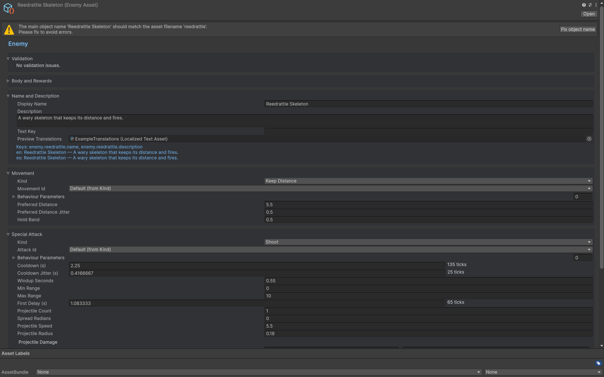

# Enemies

EnemyAsset converts scaled health/contact damage and movement/attack authoring into EnemyDef. Start with a template, choose movement and special attack, then inspect the wave 1/5/10 previews.

Chase, keep-distance and wander/offset movements have different parameter needs. Shoot, Charge and Summon special attacks can override movement while active. Summon entries reference EnemyAssets. Use Behaviour/Parameters to register a custom movement/attack without replacing all enemies.

Configure body/hit radius, speed, rewards, neutral behaviour and status immunities alongside attack timing. Enum immunities map built-in statuses; StatusImmunityIds covers explicit behaviour ids. Verify contact and projectile outcomes in a real wave as well as a static inspector preview.

## Entry point and reference fields

**Entry point:** Assets/Create/Survivor Roguelite Maker/Content/Enemy

| Field / API | Purpose |
|---|---|
| `Health / ContactDamage` | Scaled values: Base, PerWave, Min |
| `Movement / Attack` | Authored movement and special attack |
| `IsBoss / Phases` | Boss lifecycle |
| `StatusImmunities / StatusImmunityIds` | Built-in and custom status immunity |

## Figure

Enemy inspector with movement, special attack and scaled combat fields.

## Check your result

Validate connected content before starting a new measurement or run. Keep the settings, seed and content version with any result you compare. For code-only adapters, compile against the package version you ship and configure the required authored data before gameplay.

[Documentation home](../index.md) · [Content](content.md) · [Characters](characters.md) · [Weapons](weapons.md)
