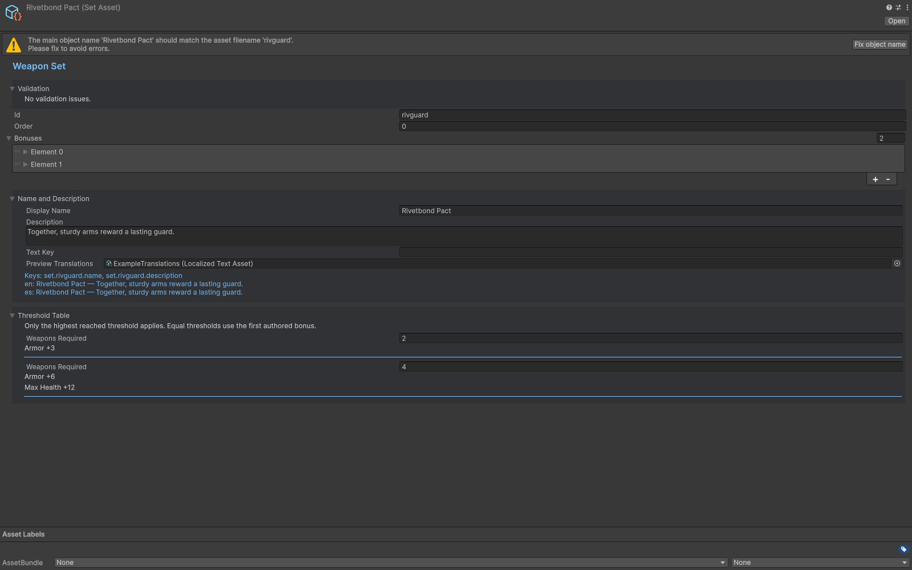

# Items, upgrades and sets

Use Item for shop stock and Upgrade for level-up stat rewards. Availability and channel policy determine where a definition appears. Explicit authoring switches such as Use Acquisition, Use Pool Constraints and Use Trigger Rules preserve older data when off; enable the appropriate switch before relying on its extended fields.

Pool settings cover tier weights, tag weights, kind-specific slots, family constraints, character preferences/bans, guarantees and banish allowances. Guarantees select from eligible candidates. Full-slot weapon merges and next-tier replacement follow the acquisition/shop rules. Validate each tier and use Offer Odds with the intended character, mode, progress and inventory configuration.

Sets count weapon membership. Duplicate references to one set on a weapon count once. Only the highest reached threshold applies, with the first entry winning an equal threshold. Character policy tags control preferences and bans; inventory tags describe owned content.

Ids connect authoring, views, offers and saves. Keep them stable after shipping. Id comparison is case-sensitive. Within an offer window, duplicate prevention uses ids; inventory counts, combining and sets use definition-object identity. Reuse one asset/definition object for each content entry.

The asset conversion cache preserves repeated references as the same definition object. Treat converted definitions as immutable during a run. Start a fresh run after changing authoring assets; code that deliberately invalidates the cache must re-register its runtime custom handlers on the new graph.

An owned item has an instance id, acquisition/expiry waves, counters and effect leases. Keep `Items` and `ItemInstances` aligned: use `RunState.AddItem`, `RemoveItem`, `ReplaceItem` and `MergeItems` for runtime mutations. Route player-facing changes through `RunController` so eligibility, triggers and live Field updates also run.

## Entry point and reference fields

**Entry point:** Assets/Create/Survivor Roguelite Maker/Content/Item

| Field / API | Purpose |
|---|---|
| `Kind` | Item for stock, Upgrade for level-up rewards |
| `MaxOwned` | Owned-copy cap |
| `LifetimeWaves` | Optional item expiry |
| `SetDef.Order` | Stable set evaluation order |
| `SetBonus.Count` | Highest reached threshold only |

## Figure

Weapon Set inspector with its threshold table and bonuses.

## Check your result

Validate connected content before starting a new measurement or run. Keep the settings, seed and content version with any result you compare. For code-only adapters, compile against the package version you ship and configure the required authored data before gameplay.

[Documentation home](../index.md) · [Content](content.md) · [Characters](characters.md) · [Weapons](weapons.md)
