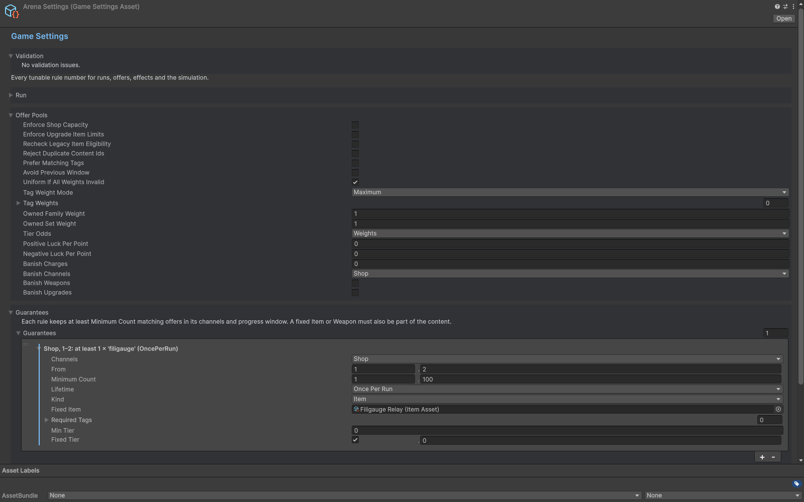

# Offers

Use Item for shop stock and Upgrade for level-up stat rewards. Availability and channel policy determine where a definition appears. Explicit authoring switches such as Use Acquisition, Use Pool Constraints and Use Trigger Rules preserve older data when off; enable the appropriate switch before relying on its extended fields.

Pool settings cover tier weights, tag weights, kind-specific slots, family constraints, character preferences/bans, guarantees and banish allowances. Guarantees select from eligible candidates. Full-slot weapon merges and next-tier replacement follow the acquisition/shop rules. Validate each tier and use Offer Odds with the intended character, mode, progress and inventory configuration.

Sets count weapon membership. Duplicate references to one set on a weapon count once. Only the highest reached threshold applies, with the first entry winning an equal threshold. Character policy tags control preferences and bans; inventory tags describe owned content.

## Entry point and reference fields

**Entry point:** Assets/Create/Survivor Roguelite Maker/Game Settings

| Field / API | Purpose |
|---|---|
| `Available` | Global eligibility gate |
| `UseAcquisition` | Opt into asset acquisition policy |
| `Tags / PoolGroups` | Weights, filters and bans |
| `Guarantees` | Eligible guaranteed candidates |
| `FieldWeaponChance` | Field choice category weight |

## Figure

Game Settings inspector with pool eligibility and guarantee rules.

## Check your result

Validate connected content before starting a new measurement or run. Keep the settings, seed and content version with any result you compare. For code-only adapters, compile against the package version you ship and configure the required authored data before gameplay.

[Documentation home](../index.md) · [Content](content.md) · [Characters](characters.md) · [Weapons](weapons.md)
