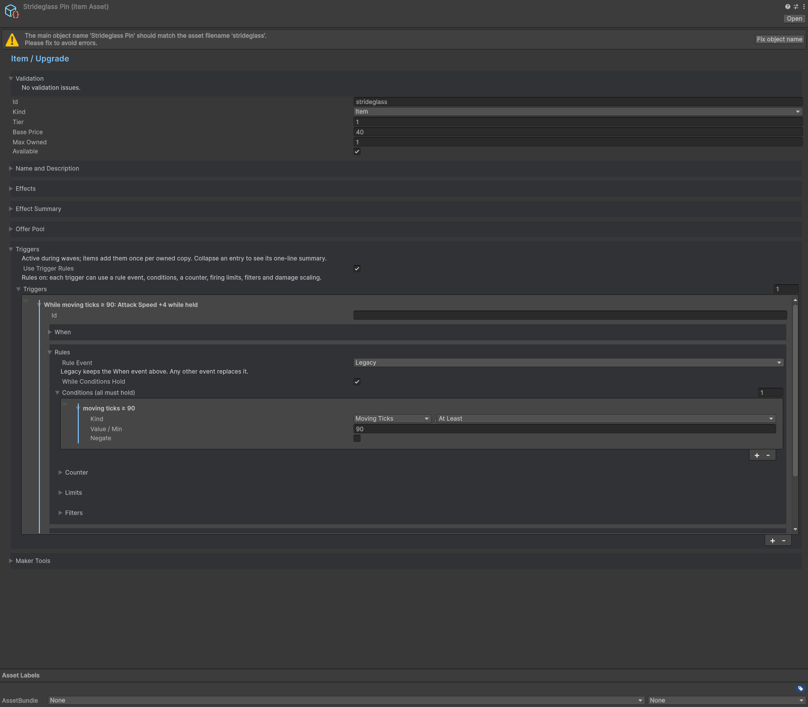

# Triggers

Items and characters can author triggers. Legacy When rules remain available; enable Use Trigger Rules for explicit events, conditions and counters. Combat events and run events are evaluated by different adapters. Run events cover actions such as entering a shop, rerolling or changing waves; combat events cover hits, kills, healing, status application and other wave facts.

Conditions test health intervals, movement, time without damage, stats and counters. Configure thresholds for event accumulation. Use WhileConditionsHold to maintain a temporary stat. Use event rules for death/source-slot filters and counters. TempStat reads Amount; ApplyStatus reads its status definition.

Enable Use Trigger Rules before configuring Include Reactions, Include Neutral and Allow Dead Owner. Resolve the reported validation issues. Custom actions need an installed handler; see [Extending](../extending/index.md).

## Entry point and reference fields

**Entry point:** Assets/Create/Survivor Roguelite Maker/Content/Item

| Field / API | Purpose |
|---|---|
| `UseTriggerRules` | Enable explicit rule authoring |
| `Event / Conditions` | Fact selector and gates |
| `CounterThreshold / CounterReset` | Accumulation policy |
| `WhileConditionsHold` | Maintained temporary-stat path |
| `Action / Handler` | Built-in or registered custom action |

## Figure

Item inspector with trigger event, action and condition fields.

## Check your result

Validate connected content before starting a new measurement or run. Keep the settings, seed and content version with any result you compare. For code-only adapters, compile against the package version you ship and configure the required authored data before gameplay.

[Documentation home](../index.md) · [Content](content.md) · [Characters](characters.md) · [Weapons](weapons.md)
