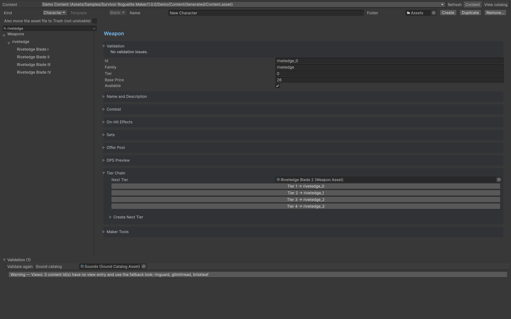

# Weapon Tiers

Give every tier a unique Id, keep its Family consistent, and connect NextTier without cycles. The inspector displays the chain and offers a next-tier creation action with scaling/registration choices. Review its proposed values before accepting.

Register tiers in Content.Weapons and keep starting choices separate. Shop/acquisition settings control equal-definition merges, next-tier replacements and candidate eligibility at full capacity. MergeOnFullSlots matters at full capacity.

Test at both a free slot and a full slot, including a held terminal tier. Validate that the offer pool never presents an unreceivable candidate. Use the tier chain for weapon progression.

## Entry point and reference fields

**Entry point:** Assets/Create/Survivor Roguelite Maker/Content/Weapon

| Field / API | Purpose |
|---|---|
| `Tier` | Tier index; zero is the lowest |
| `Family` | Family grouping |
| `NextTier` | Next definition/reference |
| `MergeOnFullSlots` | Allow configured full-slot merging |
| `WeaponSlots` | Capacity for acquisition checks |

## Figure

Weapon inspector displaying the connected tier chain.

## Check your result

Validate connected content before starting a new measurement or run. Keep the settings, seed and content version with any result you compare. For code-only adapters, compile against the package version you ship and configure the required authored data before gameplay.

[Documentation home](../index.md) · [Content](content.md) · [Characters](characters.md) · [Weapons](weapons.md)
