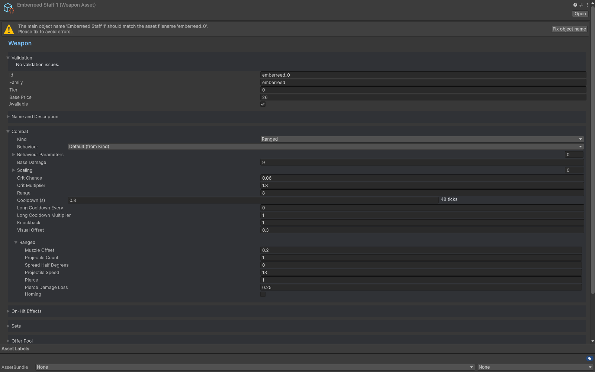

# Weapons

Use the template create menu for **Weapon - Ranged**, **Weapon - Melee**, **Weapon - Orbit** or **Weapon - Aura**. The inspector shows fields for the selected kind and a tier-chain overview.

- Ranged weapons select the closest target center, check range against its hit radius, aim and fire a spread. Projectile Count adds the configured player stat. A nonpositive projectile speed emits no projectile. Homing turns toward the nearest target at the configured angular rate.
- Melee weapons use Windup, Strike and Return phases. Thrust extension uses the configured ease curve; swing angle advances linearly. Hit checks use the oriented box expanded along each axis by the target's radius. Alternating styles and return hits are explicit options.
- Orbit weapons place blades around the primary player, rotate them and share an enemy rehit timer across their blades. Damage/crit is refreshed on their cooldown pulses.
- Aura weapons pulse through all targets inside their center-radius check on cooldown.

Damage, scaling coefficients, critical chance/multiplier, offsets, range and cooldown are definition/settings fields. The inspector's expected DPS is a model; measured DPS depends on enemy density, reach, movement, on-hit effects and the selected scenario. Use Weapon Lab and Build Lab together.

On Hit effects are checked in authored order. Explode damages other enemies near the hit, Chain jumps to unvisited nearby enemies with falloff, and Apply Status calls the status system. Secondary damage does not recursively roll the same weapon effects.

Behaviour is optional. Empty means the built-in id for Kind; a custom string must be registered before wave start. Parameters are ordered key/number/text entries read by custom code. Read the required Kind fields explicitly in your custom implementation.

Use the inspector's next-tier creation action to clone/scale a weapon and link it. Review the proposed id, price, damage/range/cooldown settings and any catalog/content registration options. Inspect the entire chain for cycles before shipping.

## Entry point and reference fields

**Entry point:** Assets/Create/Survivor Roguelite Maker/Content/Weapon

| Field / API | Purpose |
|---|---|
| `Combat.Kind` | Ranged / Melee / Orbit / Aura |
| `Behaviour / Parameters` | Registered custom id and authored values |
| `BaseDamage / Scaling` | Damage formula inputs |
| `Range / CooldownTicks` | Reach and timing |
| `OnHit` | Ordered secondary effects |

## Figure

Weapon inspector with ranged combat fields.

## Check your result

Validate connected content before starting a new measurement or run. Keep the settings, seed and content version with any result you compare. For code-only adapters, compile against the package version you ship and configure the required authored data before gameplay.

[Documentation home](../index.md) · [Content](content.md) · [Characters](characters.md) · [Weapon Tiers](weapon-tiers.md)
