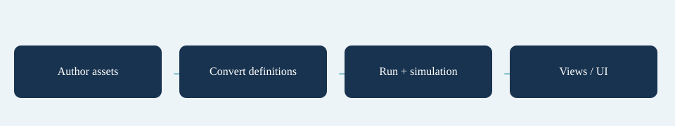

# Architecture

| Layer | Responsibility | Key entry points |
|---|---|---|
| Core | Stats, effects, dependency evaluation, explicit conversions | `StatBuild`, `Effect`, `IStatSource` |
| Simulation | One wave, fixed ticks, entities, damage, events | `WaveSimulation`, `SimWorld`, `SimSystems` |
| Run | Inventory, level-ups, shops, wave transitions, saves and unlocks | `RunController`, `RunState`, `RunSystems` |
| Data | ScriptableObject authoring and cached definition conversion | `ContentAsset.BuildRunContent()` |
| Presentation | Input, fixed-step clock, pooled views, UI, audio and options | `SurvivorsGame`, `SurvivorsSceneBootstrap` |
| Balance / Editor | Headless experiments and authoring tools | `MakerAnalysis`, `IMakerAnalysis` |

Core, Simulation and Run do not reference UnityEngine. Definitions describe what can happen; state objects describe what is happening now. Views read state and events, and UI requests actions through the controller/session. Editing a view must not change combat outcomes.

## Entry point and reference fields

**Entry point:** Code-only: use the API reference for the named types.

| Field / API | Purpose |
|---|---|
| `Definition` | Read-only authored rules |
| `State` | Mutable data for one active run/wave |
| `Presentation` | Reads state; requests controller actions |

## Figure

Concept diagram.

## Check your result

Validate connected content before starting a new measurement or run. Keep the settings, seed and content version with any result you compare. For code-only adapters, compile against the package version you ship and configure the required authored data before gameplay.

[Documentation home](../index.md) · [Ticks](ticks.md) · [Definitions](definitions.md) · [Run Loop](run-loop.md)
