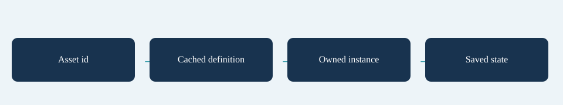

# Definitions

Ids connect authoring, views, offers and saves. Keep them stable after shipping. Id comparison is case-sensitive. Within an offer window, duplicate prevention uses ids; inventory counts, combining and sets use definition-object identity. Reuse one asset/definition object for each content entry.

The asset conversion cache preserves repeated references as the same definition object. Treat converted definitions as immutable during a run. Start a fresh run after changing authoring assets; code that deliberately invalidates the cache must re-register its runtime custom handlers on the new graph.

An owned item has an instance id, acquisition/expiry waves, counters and effect leases. Keep `Items` and `ItemInstances` aligned: use `RunState.AddItem`, `RemoveItem`, `ReplaceItem` and `MergeItems` for runtime mutations. Route player-facing changes through `RunController` so eligibility, triggers and live Field updates also run.

## Entry point and reference fields

**Entry point:** Code-only: use the API reference for the named types.

| Field / API | Purpose |
|---|---|
| `Id` | Stable case-sensitive external identity |
| `InstanceId` | Owned-copy identity |
| `EffectIndex` | Position within the owner recipe |
| `Cache` | Preserves reference identity across converted assets |

## Figure

Concept diagram.

## Check your result

Validate connected content before starting a new measurement or run. Keep the settings, seed and content version with any result you compare. For code-only adapters, compile against the package version you ship and configure the required authored data before gameplay.

[Documentation home](../index.md) · [Architecture](architecture.md) · [Ticks](ticks.md) · [Run Loop](run-loop.md)
