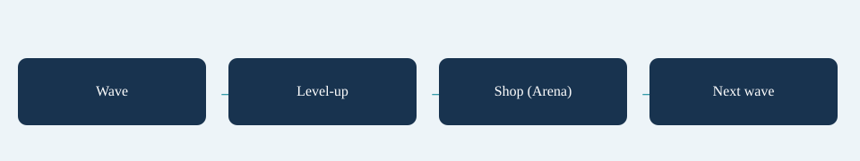

# Run Loop

**Arena:** run a timed wave, resolve queued level-ups, enter a shop, then begin the next wave. The final survived wave wins immediately after settlement. New Arena waves refill health.

**Field:** continuous waves with no shop. A level-up pauses after the current tick, offers upgrades and eligible weapons, applies the selection and resumes the same wave. `FieldCarryHealth` controls health carried between waves. Field offer progress uses level; Arena offer progress uses wave number.

A choice window avoids duplicate ids, searches lower tiers when a requested tier has no candidates, and can end early when no choices exist. A full weapon inventory only offers weapons the acquisition rules can currently accept. Use [Offer Odds](../tools/index.md) to inspect this under your settings.

## Entry point and reference fields

**Entry point:** Code-only: use the API reference for the named types.

| Field / API | Purpose |
|---|---|
| `RunPhase` | Controller action boundary |
| `FieldCarryHealth` | Carry health between Field waves |
| `PendingLevelUps` | Queued choices |
| `RunResult` | Check success before assuming mutation |

## Figure

Concept diagram.

## Check your result

Validate connected content before starting a new measurement or run. Keep the settings, seed and content version with any result you compare. For code-only adapters, compile against the package version you ship and configure the required authored data before gameplay.

[Documentation home](../index.md) · [Architecture](architecture.md) · [Ticks](ticks.md) · [Definitions](definitions.md)
