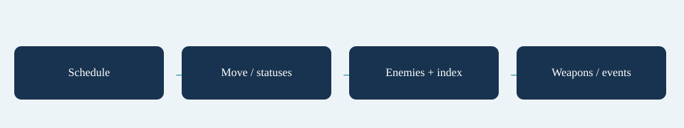

# Ticks

Positions and ranges are world units. The default simulation frequency is 60 ticks per second and is configured by `SimSettings.TicksPerSecond`. Convert authored seconds with `SimSettings.Ticks`; do not assume a fixed conversion in custom systems. Percent stats use the configured stat bindings and percentage conversion; percent stats use percentage points, and probability fields such as hit-effect Chance use fractions from 0 to 1.

Each running tick schedules spawns, moves players, updates weapon anchors, advances statuses and enemies, admits behaviour spawns, rebuilds the spatial index, ticks weapons/projectiles, resolves deaths/triggers/pickups and regeneration, then performs end checks. Modules expose named boundaries in this order. Read [Extending](../extending/index.md) for the exact module phases.

Events belong to one tick. Consume `world.Events` after the simulation step, before the next step clears it. Presentation keeps interpolation snapshots of positions and renders between ticks; the interpolation alpha never changes simulation time.

## Entry point and reference fields

**Entry point:** Code-only: use the API reference for the named types.

| Field / API | Purpose |
|---|---|
| `TicksPerSecond` | Simulation frequency; default 60 |
| `SimSettings.Ticks` | Seconds-to-ticks conversion |
| `Events` | Only the current tick |
| `alpha` | Render interpolation only |

## Figure

Concept diagram.

## Check your result

Validate connected content before starting a new measurement or run. Keep the settings, seed and content version with any result you compare. For code-only adapters, compile against the package version you ship and configure the required authored data before gameplay.

[Documentation home](../index.md) · [Architecture](architecture.md) · [Definitions](definitions.md) · [Run Loop](run-loop.md)
