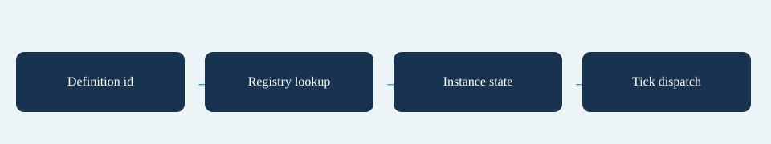

# Behaviours

`SimSystems.Behaviours` groups weapon, enemy movement/attack, status and pickup registries. Ids are case-sensitive; registering an existing id replaces it. An empty definition Behaviour uses the built-in id for its enum Kind. Register before starting waves; weapon slots resolve/cache their behaviour at Begin.

Implement `IWeaponBehaviour.Begin/Tick`, `IEnemyMovement.Init/Step`, `IEnemyAttack.Init/Tick/OverridesMovement`, `IStatusBehaviour.Applied/Tick/Modify` or `IPickupBehaviour.Collect` as appropriate. Parameters are definition data; per-instance state belongs in `WeaponState.BehaviourState`, enemy movement/attack state or `StatusInstance.State`.

This center-radius pulse reads Range, BaseDamage, Scaling and CooldownTicks. Extend its Tick method to add critical rolls, attack-speed scaling and additional hit effects.

```csharp
using System;
using System.Collections.Generic;
using SurvivorsMaker.Simulation;

namespace MakerManualExamples
{
    public sealed class ExamplePulseWeapon : IWeaponBehaviour
    {
        sealed class State
        {
            public readonly List<Enemy> Candidates;
            public State(int capacity) { Candidates = new List<Enemy>(capacity); }
        }

        public void Begin(SimWorld world, WeaponState weapon)
        {
            weapon.BehaviourState = new State(Math.Max(1, world.Wave.MaxAlive));
        }

        public void Tick(SimWorld world, WeaponState weapon)
        {
            if (weapon.CooldownLeft > 0) { weapon.CooldownLeft--; return; }
            var def = weapon.Def;
            var radius = Math.Max(0f, def.Range);
            var damage = world.Settings.Weapons.Damage.Hit(def.BaseDamage, def.Scaling, world.Stats);
            weapon.PendingDamage = damage;
            weapon.PendingCrit = false;
            weapon.LastAttackTick = world.Tick;
            world.Emit(SimEventKind.WeaponFired, weapon.Anchor, slot: weapon.Slot);
            var state = (State)weapon.BehaviourState;
            world.Spatial.QueryEnemies(weapon.Anchor, radius, state.Candidates);
            for (var i = 0; i < state.Candidates.Count; i++)
            {
                var enemy = state.Candidates[i];
                if (enemy.Dead || enemy.Health <= 0) continue;
                var direction = enemy.Position - weapon.Anchor;
                if (direction.LengthSquared > radius * radius) continue;
                world.HitSource = def;
                try { world.Combat.HitEnemy(world, enemy, damage, false, weapon.Slot, direction, def.Knockback); }
                finally { world.HitSource = null; }
            }
            world.EmitCustom("example.pulse", weapon.Anchor, damage, slot: weapon.Slot);
            weapon.CompletedAttacks++;
            weapon.CooldownLeft = Math.Max(1, Math.Max(world.Settings.Weapons.MinCooldownTicks, def.CooldownTicks)) - 1;
        }
    }
}
```

Set the weapon's Behaviour to `example.pulse` and register the type as shown below. Validate your fields before play. Spatial queries return candidates in stable order; keep an exact test. If your shape includes a target's hit radius, expand the query conservatively before that exact test. Do not rebuild the shared index from a weapon.

For custom friendly projectiles, rent with `world.Pools.RentProjectile()`, assign a fresh `world.NewId()` and all required fields, then append to `world.FriendlyProjectiles`. The weapon system moves/checks those projectiles; the system that removes them from the list returns them. Never retain returned objects across ticks.

## Entry point and reference fields

**Entry point:** Code-only: use the API reference for the named types.

| Field / API | Purpose |
|---|---|
| `Behaviour` | Case-sensitive registry id |
| `Parameters` | Definition key/value/text inputs |
| `BehaviourState` | Weapon-instance state |
| `Pools / Spatial` | Use shared lifecycle/query contracts |

## Figure



Concept diagram.

## Check your result

Validate connected content before starting a new measurement or run. Keep the settings, seed and content version with any result you compare. For code-only adapters, compile against the package version you ship and configure the required authored data before gameplay.

[Documentation home](../index.md) · [Index](index.md) · [Modules Events](modules-events.md) · [Effect Trigger Handlers](effect-trigger-handlers.md)
