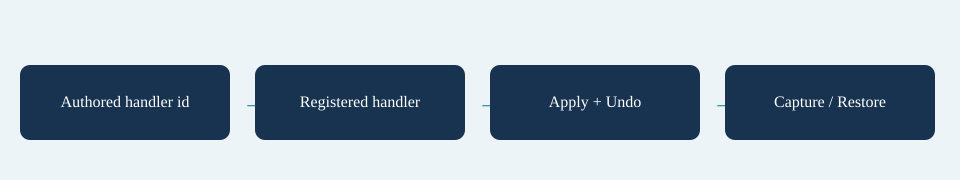

# Effect Trigger Handlers

Set Effect.Handler to your registered id. A handler must return an `AppliedEffect` containing itself and enough state to undo the actual contribution. Do not mutate shared Effect definitions. Implement IEffectStatePersistence for saveable applications.

This additive example is intentionally small so its capture/restore/undo contract is visible:

```csharp
using System;
using System.Globalization;
using SurvivorsMaker.Core;
using SurvivorsMaker.Simulation;

namespace MakerManualExamples
{
    public sealed class ExampleSavedEffect : IEffectStatePersistence
    {
        AppliedEffect Add(Effect effect, EffectStore store, int value)
        {
            store.Values[effect.Target] = store.Get(effect.Target) + value;
            store.Touch();
            return new AppliedEffect(effect, true, handler: this, state: value);
        }
        public AppliedEffect Apply(Effect effect, EffectStore store) => Add(effect, store, effect.Amount);
        public void Undo(AppliedEffect applied, EffectStore store)
        {
            store.Values[applied.Effect.Target] = store.Get(applied.Effect.Target) - (int)applied.State;
            store.Touch();
        }
        public string Capture(AppliedEffect applied) => ((int)applied.State).ToString(CultureInfo.InvariantCulture);
        public AppliedEffect Restore(Effect effect, EffectStore store, string payload)
        {
            if (!int.TryParse(payload, NumberStyles.Integer, CultureInfo.InvariantCulture, out var value))
                throw new ArgumentException("Invalid example effect payload.");
            return Add(effect, store, value);
        }
    }
}
```

Validate handler ranges, payload versions and arithmetic. Restore must apply the saved contribution to the supplied Store and return an Undo record for the supplied Effect. Capture/Restore must not use time, randomness or mutable handler-global state. Call Store.Touch after writes. Read handler contributions in the Store residual returned by StatBuild.Explain.

Combat uses `ITriggerHandler.Fire(SimWorld, TriggerDef, Vec2)`. Run events use `IRunTriggerHandler.Fire(RunState, TriggerDef, RunTriggerFact)`. These are separate registries. Set Trigger Action to Custom and Handler to the registered id; author a matching event or legacy When and enable extended rule authoring when using explicit conditions/counters.

```csharp
using SurvivorsMaker.Simulation;

namespace MakerManualExamples
{
    public sealed class ExampleNoticeTrigger : ITriggerHandler
    {
        public void Fire(SimWorld world, TriggerDef trigger, Vec2 position)
        {
            world.EmitCustom("example.notice", position, trigger.Amount);
        }
    }
}
```

When hosting RunController yourself, register before Create/StartWave:

```csharp
using SurvivorsMaker.Core;
using SurvivorsMaker.Run;

namespace MakerManualExamples
{
    public static class ExampleControllerFactory
    {
        public static RunController Create(RunRequest request, int telemetryTicks)
        {
            var systems = RunSystems.CreateDefault();
            systems.Simulation.Behaviours.Weapons.Register("example.pulse", new ExamplePulseWeapon());
            systems.Simulation.Modules.Add(new ExampleTelemetryModule(telemetryTicks));
            if (request.Content.EffectHandlers == null) request.Content.EffectHandlers = new EffectHandlers();
            request.Content.EffectHandlers.Register("example.saved", new ExampleSavedEffect());
            var controller = new RunController(systems);
            controller.TriggerHandlers["example.notice"] = new ExampleNoticeTrigger();
            controller.Create(request);
            return controller;
        }
    }
}
```

Call StartWave after configuring profile/run stores if needed. For run-side custom actions, add your `IRunTriggerHandler` to `controller.RunTriggerHandlers` at the same boundary. Registering handlers does not create the corresponding effects/triggers in your content; both authoring and code registration are required.

## Entry point and reference fields

**Entry point:** Code-only: use the API reference for the named types.

| Field / API | Purpose |
|---|---|
| `IEffectHandler` | Apply and Undo |
| `IEffectStatePersistence` | Capture and Restore |
| `ITriggerHandler` | Combat custom action |
| `IRunTriggerHandler` | Run-event custom action |

## Figure



Concept diagram.

## Check your result

Validate connected content before starting a new measurement or run. Keep the settings, seed and content version with any result you compare. For code-only adapters, compile against the package version you ship and configure the required authored data before gameplay.

[Documentation home](../index.md) · [Index](index.md) · [Behaviours](behaviours.md) · [Modules Events](modules-events.md)
