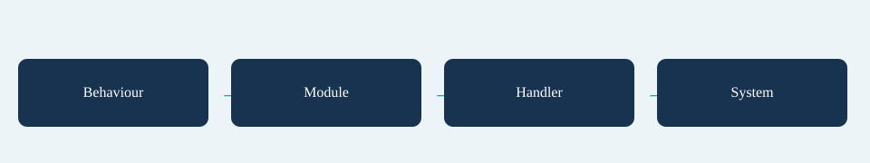

# Index

Keep extension code in your own Assets folder and namespace. Reference the package assemblies from your asmdef: Core, Simulation, Run, Data, Presentation or Balance as needed. Core/Simulation/Run do not reference UnityEngine.

Choose the narrowest adapter: a behaviour registry for one attack/movement/status/pickup, ISimModule for fixed phase work, IEffectHandler/ITriggerHandler for authored actions, ISceneBootstrapExtension for wiring, or an entire system interface for a genuinely different rules engine. Keep per-instance state out of registry singletons.

The complete examples across this chapter use MakerManualExamples. Include the referenced earlier types together and save public MonoBehaviours in matching filenames. Configure scene references, animation clips and authored data before running an example.

## Entry point and reference fields

**Entry point:** Code-only: use the API reference for the named types.

| Field / API | Purpose |
|---|---|
| `SimSystems` | Wave systems and behaviours |
| `RunSystems` | Run rules and simulation bundle |
| `IWaveView` | Read-only presentation lifecycle |

## Figure

Concept diagram.

## Check your result

Validate connected content before starting a new measurement or run. Keep the settings, seed and content version with any result you compare. For code-only adapters, compile against the package version you ship and configure the required authored data before gameplay.

[Documentation home](../index.md) · [Behaviours](behaviours.md) · [Modules and events](modules-events.md) · [Effect and trigger handlers](effect-trigger-handlers.md)
