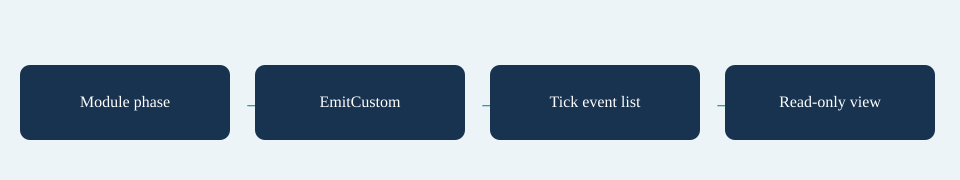

# Modules and events

Modules run in list order at six fixed boundaries: After Schedule, Before Enemies, After Enemies, After Combat, After Deaths and End Of Tick. They receive Begin once for each new world. Keep mutable state per world/instance, not in a global singleton. Use only `world.Random` for gameplay randomness.

This stateless telemetry module emits values without changing gameplay:

```csharp
using System;
using SurvivorsMaker.Simulation;

namespace MakerManualExamples
{
    public sealed class ExampleTelemetryModule : ISimModule
    {
        readonly int _interval;
        public ExampleTelemetryModule(int intervalTicks) { _interval = Math.Max(1, intervalTicks); }
        public void Begin(SimWorld world) { }
        public void Tick(SimWorld world, SimModulePhase phase)
        {
            if (phase == SimModulePhase.EndOfTick && world.Tick % _interval == 0)
                world.EmitCustom("example.population", world.Player.Position, world.Enemies.Count);
        }
    }
}
```

Place an `ISceneBootstrapExtension` component beside `SurvivorsSceneBootstrap`. Configure Systems runs before the game is configured; Scene Configured runs after the view/UI/catalog wiring. The latter can attach presentation handlers and register effects on the converted content graph before gameplay begins.

```csharp
using SurvivorsMaker.Core;
using SurvivorsMaker.Presentation;
using SurvivorsMaker.Run;
using UnityEngine;

namespace MakerManualExamples
{
    public sealed class ExampleSceneExtension : MonoBehaviour, ISceneBootstrapExtension
    {
        [Min(1)] public int TelemetryTicks = 60;
        public SpriteRenderer PulseMarker;

        public void ConfigureSystems(RunSystems systems)
        {
            systems.Simulation.Behaviours.Weapons.Register("example.pulse", new ExamplePulseWeapon());
            systems.Simulation.Modules.Add(new ExampleTelemetryModule(TelemetryTicks));
        }
        public void SceneConfigured(SurvivorsSceneBootstrap bootstrap)
        {
            var definitions = bootstrap.Content.BuildRunContent();
            if (definitions.EffectHandlers == null) definitions.EffectHandlers = new EffectHandlers();
            definitions.EffectHandlers.Register("example.saved", new ExampleSavedEffect());
            bootstrap.View.RegisterCustomEvent("example.pulse", new ExamplePulseView(PulseMarker));
        }
    }
}
```

```csharp
using SurvivorsMaker.Presentation;
using SurvivorsMaker.Simulation;
using UnityEngine;

namespace MakerManualExamples
{
    public sealed class ExamplePulseView : ICustomEventView
    {
        readonly SpriteRenderer _marker;
        public ExamplePulseView(SpriteRenderer marker) { _marker = marker; }
        public void Show(SimEvent value, SimWorld world, WorldView view)
        {
            if (_marker != null)
                _marker.transform.position = new Vector3(value.Position.X, value.Position.Y, _marker.transform.position.z);
        }
    }
}
```

The marker moves a pre-existing sprite. Use a presentation pool for transient effects. You can also configure custom event effects in Presentation Settings and sound mappings in the sound catalog. `CustomEventRaised` exposes copied event values to listeners. Views must not damage enemies, consume gameplay randomness or mutate the world.

Register systems and views through ISceneBootstrapExtension. For controller trigger registries, use the direct-controller factory before Create/StartWave. Repeat registration for each newly created controller.

## Entry point and reference fields

**Entry point:** Code-only: use the API reference for the named types.

| Field / API | Purpose |
|---|---|
| `ISimModule.Begin` | Once per new world |
| `SimModulePhase` | Six stable phase boundaries |
| `SimEvent.CustomId` | Value event identity |
| `ICustomEventView.Show` | Read-only event display |

## Figure



Concept diagram.

## Check your result

Validate connected content before starting a new measurement or run. Keep the settings, seed and content version with any result you compare. For code-only adapters, compile against the package version you ship and configure the required authored data before gameplay.

[Documentation home](../index.md) · [Index](index.md) · [Behaviours](behaviours.md) · [Effect and trigger handlers](effect-trigger-handlers.md)
