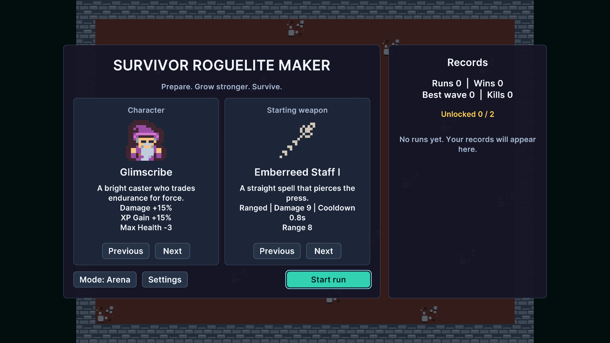

# Five-minute demo

In Package Manager, select this package and import **Demo**. Imported files live below `Assets/Samples/Survivor Roguelite Maker/<package version>/Demo/`. Work with the imported copy.

Choose **Tools/Survivor Roguelite Maker/Prepare Demo Text Resources** and wait for the TMP Essential Resources import to finish. Then choose **Tools/Survivor Roguelite Maker/Build Demo** to build the imported sample.

Find and open `ArenaDemo.unity` under that sample's `Scenes` folder. The scene bootstrap uses one scene for the menu's Arena/Field mode switch. The sample builder regenerates its authored output, so use your own folder for lasting changes. Keep only one imported sample copy to avoid duplicate scripts/GUIDs.

Create an independent game through Tools/Survivor Roguelite Maker/New Game Project....

### Play the first loop

Choose a character, a starting weapon and mode. Start, move to avoid contact and let automatic attacks run. Pause to inspect options. In Arena mode survive a wave, make queued upgrade selections and visit the shop; in Field mode selections interrupt the current wave. A successful setup displays health, experience, level, wave and currency and can transition through the relevant screens.

## Entry point and reference fields

**Entry point:** Tools/Survivor Roguelite Maker/Build Demo

| Field / API | Purpose |
|---|---|
| `Seed` | Use a fixed nonzero seed while comparing attempts |
| `Mode` | Arena shows shops; Field resumes interrupted combat |
| `Input` | Movement and pause come from IPlayerInput |

## Figure

Product capture.

## Check your result

Validate connected content before starting a new measurement or run. Keep the settings, seed and content version with any result you compare. For code-only adapters, compile against the package version you ship and configure the required authored data before gameplay.

[Documentation home](../index.md) · [Installation](installation.md) · [Samples](samples.md) · [Ten-minute first game](first-game.md)
