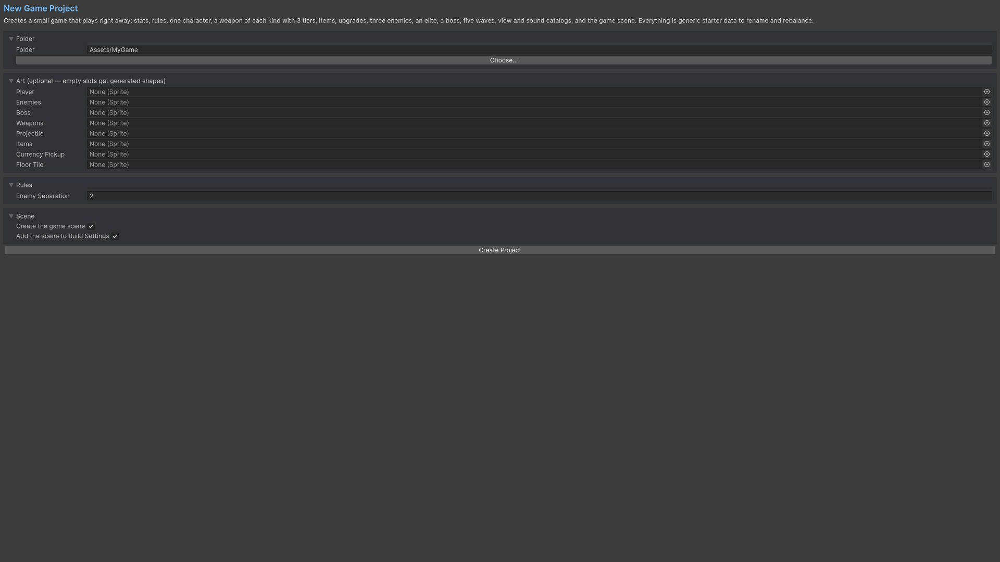

# Ten-minute first game

1. Install the package in a Unity 6 project and let scripts compile. Check that uGUI and the Input System resolved. If prompted, import TMP Essential Resources. In Player settings, use Input System or Both for Active Input Handling; restart the editor if it requests this.
2. Save your work, then choose **Tools/Survivor Roguelite Maker/New Game Project...**.
3. Choose a new folder inside `Assets`, for example `Assets/MySurvivalGame`. Leave sprites empty to use generated placeholder shapes. Keep scene creation enabled and create the project.
4. The wizard creates a stat catalog, settings, content registry, character, weapon tier chains, items/upgrades, enemies, boss/elite data, waves, arena and view/sound catalogs. Open its generated game scene if it is not already open. Save the scene.
5. Select the object with `SurvivorsSceneBootstrap`. Check Content, Views and Sounds. Assign separate Arena Settings and Field Settings if you want different rules for each mode; otherwise the content's Settings is used. A nonzero Seed is useful while testing.
6. Enter Play Mode, choose a character and starting weapon in the menu, and start. Move with the supplied movement bindings; attacks are automatic. Use the pause action for pause/options. In Arena mode, finish a wave, choose level-up rewards and shop. In Field mode, choices interrupt combat and the next wave follows automatically.

Assign audio clips to the generated sound cues and replace the placeholder visuals with your art.

## Add a first weapon

1. Choose an output folder in your Project window. Use **Assets/Create/Survivor Roguelite Maker/Templates/Weapon - Ranged**. The template initializes a `WeaponAsset`. Add it to the content registry in the following step.
2. Give it a unique Id and a player-facing Display Name. Set the damage, range, cooldown, projectile count and a positive projectile speed. The inspector's time controls display friendly units; the underlying simulation still uses ticks where the field specifies ticks.
3. Add the weapon to your `ContentAsset.Weapons` list. To offer it at the start, also add it to your character's Starting Weapons. For normal shop/level-up use, configure availability and offer-channel eligibility.
4. Add a view entry with the weapon's Id to your view catalog. Assign a sprite or prefab, and optionally a separate projectile visual. Missing visual entries use fallback rendering.
5. Open **Tools/Survivor Roguelite Maker/Weapon Lab**, assign your content/settings and weapon, and measure it against dummies. Then open **Build Lab** to test it with a character and items.
6. Validate the content in **Content Browser**, then start a fresh run to use the updated definition graph.

## Entry point and reference fields

**Entry point:** Tools/Survivor Roguelite Maker/New Game Project...

| Field / API | Purpose |
|---|---|
| `Folder` | Choose a new Assets subfolder |
| `CreateScene` | Keep enabled for the first project |
| `Sprites` | Optional; empty fields use placeholder shapes |
| `Content.Weapons` | Register the authored weapon |
| `StartingWeapons` | Separately opt it into character starting choices |

## Figure

Product capture.

## Check your result

Validate connected content before starting a new measurement or run. Keep the settings, seed and content version with any result you compare. For code-only adapters, compile against the package version you ship and configure the required authored data before gameplay.

[Documentation home](../index.md) · [Installation](installation.md) · [Samples](samples.md) · [Five-minute demo](demo.md)
