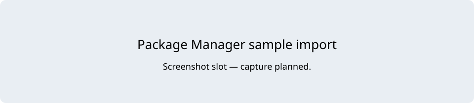

# Samples

In Package Manager, select this package and import **Survivor Roguelite Demo** (the Demo sample). Imported files live below `Assets/Samples/Survivor Roguelite Maker/<package version>/` in the sample folder selected by Package Manager. Work with that imported copy, not the package's hidden `Samples~` source.

Choose **Tools/Survivor Roguelite Maker/Build Demo**, provided by the imported sample's editor scripts. It builds the imported copy and imports missing TMP Essential Resources from the installed dependency. Find and open `ArenaDemo.unity` under that sample's `Scenes` folder. The scene bootstrap supports the menu's Arena/Field mode switch; a second scene is not required. The sample builder regenerates its authored output, so use your own folder for lasting changes. Keep only one imported sample copy to avoid duplicate scripts/GUIDs.

If a sample is not installed, the New Game Project route above remains available without it.

## Entry point and reference fields

**Entry point:** Tools/Survivor Roguelite Maker/Build Demo

| Field / API | Purpose |
|---|---|
| `Sample` | Survivor Roguelite Demo |
| `Scene` | Scenes/ArenaDemo.unity inside the imported sample |
| `Modes` | Arena and Field share that scene |

## Figure

Screenshot slot: sample-import (capture pending).

## Check your result

Validate connected content before starting a new measurement or run. Keep the settings, seed and content version with any result you compare. For code-only adapters, compile against the package version you ship and configure the required authored data before gameplay.

[Documentation home](../index.md) · [Installation](installation.md) · [Five-minute demo](demo.md) · [Ten-minute first game](first-game.md)
