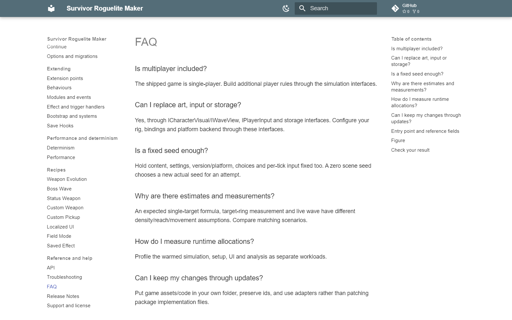

# FAQ

### Is multiplayer included?

The shipped game is single-player. Build additional player rules through the simulation interfaces.

### Can I replace art, input or storage?

Yes, through ICharacterVisual/IWaveView, IPlayerInput and storage interfaces. Configure your rig, bindings and platform backend through these interfaces.

### Is a fixed seed enough?

Hold content, settings, version/platform, choices and per-tick input fixed too. A zero scene seed chooses a new actual seed for an attempt.

### Why are there estimates and measurements?

An expected single-target formula, target-ring measurement and live wave have different density/reach/movement assumptions. Compare matching scenarios.

### How do I measure runtime allocations?

Profile the warmed simulation, setup, UI and analysis as separate workloads.

### Can I keep my changes through updates?

Put game assets/code in your own folder, preserve ids, and use adapters rather than patching package implementation files.

## Entry point and reference fields

**Entry point:** Code-only: use the API reference for the named types.

| Field / API | Purpose |
|---|---|
| `Ownership` | Project-owned assets and adapters |
| `Determinism` | Same complete input contract |
| `Performance` | Scenario-specific measurements |

## Figure

FAQ covering setup and extension workflows.

## Check your result

Validate connected content before starting a new measurement or run. Keep the settings, seed and content version with any result you compare. For code-only adapters, compile against the package version you ship and configure the required authored data before gameplay.

[Documentation home](../index.md) · [API](../reference/api.md) · [Troubleshooting](troubleshooting.md) · [Release Notes](../release-notes.md)
