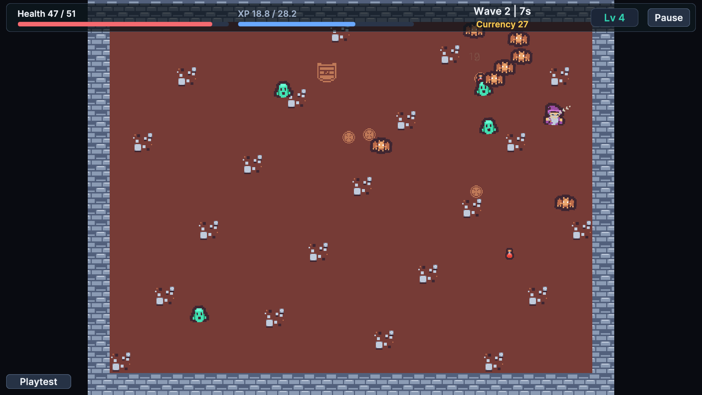

# Welcome

!!! tip "Choose your first session"
    Open the five-minute demo to learn the run loop, or create your own content with the ten-minute first-game guide.

Build a single-player survival action game with automatic weapons, waves, level-up choices and an optional shop. This manual is for designers authoring data, programmers extending rules, and teams evaluating balance before a full play session.

Start with the five-minute sample to learn the flow, or the ten-minute project wizard to own a small game immediately. Then author content, measure a build, playtest it, and iterate. Runtime rules and display are separate so a visual change does not become a hidden balance change.

Use the maker tools to author content, compare builds and measure the resulting game.

## Entry point and reference fields

**Entry point:** Tools/Survivor Roguelite Maker/New Game Project...

| Field / API | Purpose |
|---|---|
| `Content` | Your connected authoring registry |
| `Settings` | Run and simulation rules |
| `Seed` | Nonzero for repeatable comparisons |

## Figure

Product capture.

## Check your result

Validate connected content before starting a new measurement or run. Keep the settings, seed and content version with any result you compare. For code-only adapters, compile against the package version you ship and configure the required authored data before gameplay.

[Documentation home](index.md) · [Feature overview](introduction/features.md) · [Requirements](introduction/requirements.md)
