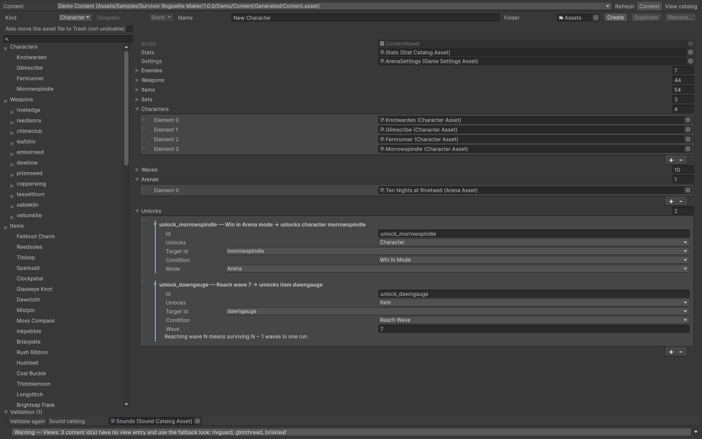

# Feature overview

| Layer | Responsibility | Key entry points |
|---|---|---|
| Core | Stats, effects, dependency evaluation, explicit conversions | `StatBuild`, `Effect`, `IStatSource` |
| Simulation | One wave, fixed ticks, entities, damage, events | `WaveSimulation`, `SimWorld`, `SimSystems` |
| Run | Inventory, level-ups, shops, wave transitions, saves and unlocks | `RunController`, `RunState`, `RunSystems` |
| Data | ScriptableObject authoring and cached definition conversion | `ContentAsset.BuildRunContent()` |
| Presentation | Input, fixed-step clock, pooled views, UI, audio and options | `SurvivorsGame`, `SurvivorsSceneBootstrap` |
| Balance / Editor | Headless experiments and authoring tools | `MakerAnalysis`, `IMakerAnalysis` |

Core, Simulation and Run do not reference UnityEngine. Definitions describe what can happen; state objects describe what is happening now. Views read state and events, and UI requests actions through the controller/session. Editing a view must not change combat outcomes.

A weapon contributes once to each referenced set. Only the highest reached threshold applies; equal thresholds use the first definition. Sets apply by ascending Order, then first encounter. Damage uses configurable formulas and stat bindings. Secondary hit effects use the combat damage path without recursively invoking the same on-hit effects.

Definitions with an empty Behaviour id retain their enum-selected built-in behaviour. Register a case-sensitive custom id before the wave starts to replace one behaviour without replacing the entire simulation. State belongs to the corresponding weapon/enemy/status instance; registry objects serve many instances. See [Extending](../extending/index.md).

The built-in game uses the primary player. Use the player list when implementing additional player rules.

## Entry point and reference fields

**Entry point:** Code-only: use the API reference for the named types.

| Field / API | Purpose |
|---|---|
| `Weapons` | Ranged, melee, orbit, aura and registered custom behaviours |
| `RunMode` | Arena or Field |
| `Analysis` | Fixed-build, whole-run, preview and offer-path experiments |

## Figure

Content Browser listing the connected content categories.

## Check your result

Validate connected content before starting a new measurement or run. Keep the settings, seed and content version with any result you compare. For code-only adapters, compile against the package version you ship and configure the required authored data before gameplay.

[Documentation home](../index.md) · [Welcome](../index.md) · [Requirements](requirements.md)
