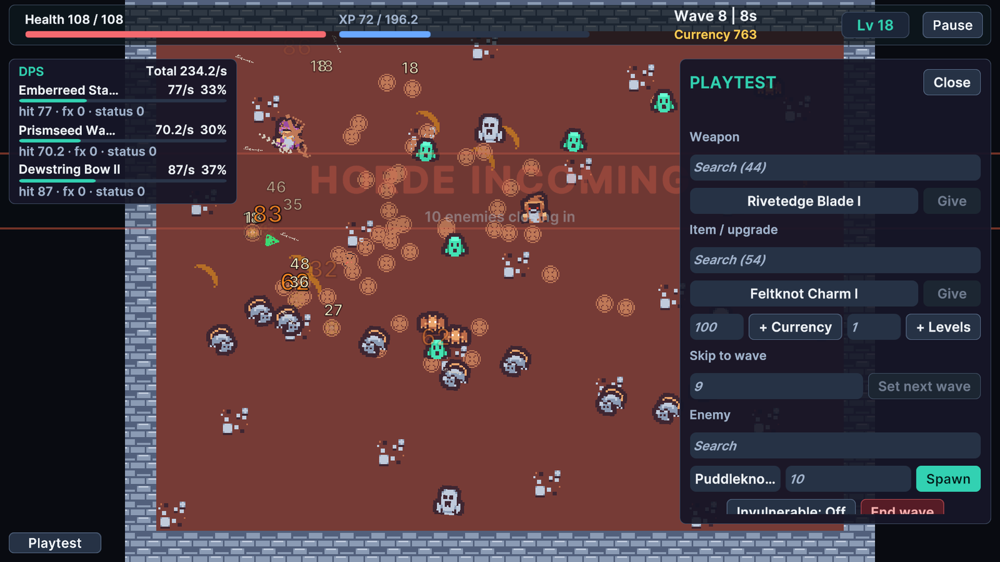

# Panel

With the generated GameUiRoot, **F2** opens the Playtest panel and **F3** toggles the DPS meter by default. GameUiRoot's DevToolsOptions controls these keys, the corner button, enabled state, speed steps and refresh interval. A missing keyboard or Key.None disables the corresponding hotkey.

The Playtest panel is compiled for the editor or Development Builds unless `SURVIVORS_MAKER_NO_PLAYTEST` is defined, and requires a debug build at runtime. Release players retain an inert component that removes itself instead of leaving a missing-script reference. The DPS meter is separately configurable and can exist in ordinary builds. Disable it if you do not want it in your shipping UI.

Commands use IPlaytestCommands on RunController. Read the result shown by the panel; successful commands apply the requested change.

| Command | When it is accepted |
|---|---|
| Give weapon | Between waves, known weapon id and a free weapon slot |
| Give item/upgrade | Between waves, or during an active Field wave; uses the item-instance path |
| Give currency | An active unfinished run and a valid positive credit |
| Give levels | An active unfinished run, valid count and representable level/health totals; choices queue through normal flow |
| Skip to wave | Between waves, a valid 1-based wave in the current arena |
| Invulnerable | An active combat wave with a living player |
| Spawn enemies | An active combat wave, known enemy id and valid positive count; bypasses normal scheduling/telegraphs/capacity |
| End wave | An active combat wave with a living player; marks it survived |

Successful state-changing commands mark UsedCheats. Such runs are excluded from normal progression-record/unlock accounting. The badge persists for that run and survives supported continue paths. A failed command does not set it. Gate production admin interfaces through your own authorization layer.

Speed controls scale SurvivorsGame's fixed-tick accumulator. Default steps range from 0.25× to 8×, bounded by GameLoopSettings. Hold stops automatic ticks without opening the pause menu. +1 Tick and +10 Ticks advance explicit fixed ticks when the game phase permits it. Level-up choices, shops and other phase barriers still stop combat processing.

Speed and single stepping do not count as cheats by themselves because they do not rewrite simulation state. They can change how live input maps onto ticks, so compare recorded per-tick input when checking determinism.

## Entry point and reference fields

**Entry point:** Play Mode > F2 (Editor/Development Build)

| Field / API | Purpose |
|---|---|
| `PlaytestKey` | F2 by default |
| `EnablePlaytest` | Enable developer panel |
| `SpeedSteps` | Configured fixed-tick speed choices |
| `UsedCheats` | Marks successful gameplay mutations |

## Figure

Playtest panel and DPS meter during an active wave.

## Check your result

Validate connected content before starting a new measurement or run. Keep the settings, seed and content version with any result you compare. For code-only adapters, compile against the package version you ship and configure the required authored data before gameplay.

[Documentation home](../index.md) · [Metrics](metrics.md)
