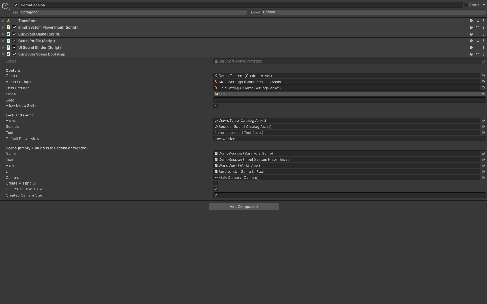

# Determinism

Keep the same package implementation, platform, content graph, settings, seed, run decisions and per-tick movement inputs. `SimRandom` is the simulation/run generator. Use `world.Random` or `run.Random` in gameplay extensions; do not use Unity random, system random, wall-clock time or unordered dictionary iteration to decide gameplay.

Reproduce exact values with the same implementation and platform. Object ids follow a monotonic world sequence, independent of pool reuse.

Set a nonzero scene bootstrap Seed while comparing builds. A zero seed tells SurvivorsGame to choose a time-based seed for each new attempt. Run decisions consume the run generator; waves receive derived seeds. Record the actual run seed, not just the authored zero value.

Presentation interpolation, sound variation and screen effects must not consume gameplay randomness. Game speed changes the number of fixed ticks processed per rendered frame; it does not change the simulation step size. For a strict comparison, replay the same per-tick inputs rather than relying on live input sampled at different frame rates.

Horde Preview scrubs recorded value frames. Between-wave save/continue preserves run state, ids and generator state. See [Saves](../saves/continue.md).

## Entry point and reference fields

**Entry point:** Code-only: use the API reference for the named types.

| Field / API | Purpose |
|---|---|
| `Seed` | Nonzero actual attempt seed |
| `world.Random / run.Random` | Gameplay generators |
| `Input` | Record per-tick values |
| `Version/platform` | Hold constant when comparing |

## Figure

Scene bootstrap configured with a fixed Seed.

## Check your result

Validate connected content before starting a new measurement or run. Keep the settings, seed and content version with any result you compare. For code-only adapters, compile against the package version you ship and configure the required authored data before gameplay.

[Documentation home](../index.md) · [Performance](performance.md)
