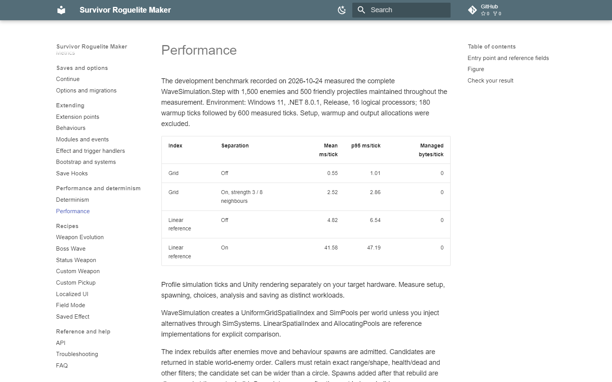

# Performance

The development benchmark recorded on 2026-10-24 measured the complete WaveSimulation.Step with 1,500 enemies and 500 friendly projectiles maintained throughout the measurement. Environment: Windows 11, .NET 8.0.1, Release, 16 logical processors; 180 warmup ticks followed by 600 measured ticks. Setup, warmup and output allocations were excluded.

| Index | Separation | Mean ms/tick | p95 ms/tick | Managed bytes/tick |
|---|---|---:|---:|---:|
| Grid | Off | 0.55 | 1.01 | 0 |
| Grid | On, strength 3 / 8 neighbours | 2.52 | 2.86 | 0 |
| Linear reference | Off | 4.82 | 6.54 | 0 |
| Linear reference | On | 41.58 | 47.19 | 0 |

Profile simulation ticks and Unity rendering separately on your target hardware. Measure setup, spawning, choices, analysis and saving as distinct workloads.

WaveSimulation creates a UniformGridSpatialIndex and SimPools per world unless you inject alternatives through SimSystems. LinearSpatialIndex and AllocatingPools are reference implementations for explicit comparison.

The index rebuilds after enemies move and behaviour spawns are admitted. Candidates are returned in stable world-enemy order. Callers must retain exact range/shape, health/dead and other filters; the candidate set can be wider than a circle. Spawns added after that rebuild are discovered at the next rebuild. Query late spawns after the next index rebuild.

Rent returns reset objects; lists/buffers can retain their capacities. Assign ids with world.NewId and all fields needed by your custom type. The code removing an object from the world list owns Return. Returning an enemy also returns its still-attached statuses. Double Return and holding stale pooled references are caller errors.

Use the default grid for late-spawn timing. Rebuild occurs after enemy movement and behaviour-spawn admission.

Separate simulation ms/tick from frame rendering/UI cost. Inspect active enemies, projectiles, view counts and separation settings. Separation is off when strength is zero; neighbour count and density affect its cost. Warm reused lists/pools before interpreting a steady-state allocation result.

Use reusable candidate lists and buffers; avoid LINQ, closures, string formatting and growing collections in hot ticks. Allocate instance state at Begin/initialization. Do not use Unity physics callbacks as an additional authoritative damage path beside the simulation.

StatBuild caches by Store/Source revision and evaluation settings identity. Custom sources must keep reads stable until Revision changes. Call Store.Touch/Invalidate as required after deliberate writes. `StatBuild.Explain` and `InventoryAnalysis` allocate only when explicitly requested from tool and UI requests.

Analysis jobs advance in budgeted slices and cancel when their context changes. Recording every preview frame or running many bot paths has a different memory/cost profile from the steady-state simulation benchmark.

## Entry point and reference fields

**Entry point:** Code-only: use the API reference for the named types.

| Field / API | Purpose |
|---|---|
| `Spatial` | Default uniform grid |
| `Pools` | Rent reset / remover Return |
| `Warmup` | Exclude setup before steady-state measurement |
| `SeparationStrength` | Zero disables separation |

## Figure

Performance guide with simulation benchmark conditions and results.

## Check your result

Validate connected content before starting a new measurement or run. Keep the settings, seed and content version with any result you compare. For code-only adapters, compile against the package version you ship and configure the required authored data before gameplay.

[Documentation home](../index.md) · [Determinism](determinism.md)
