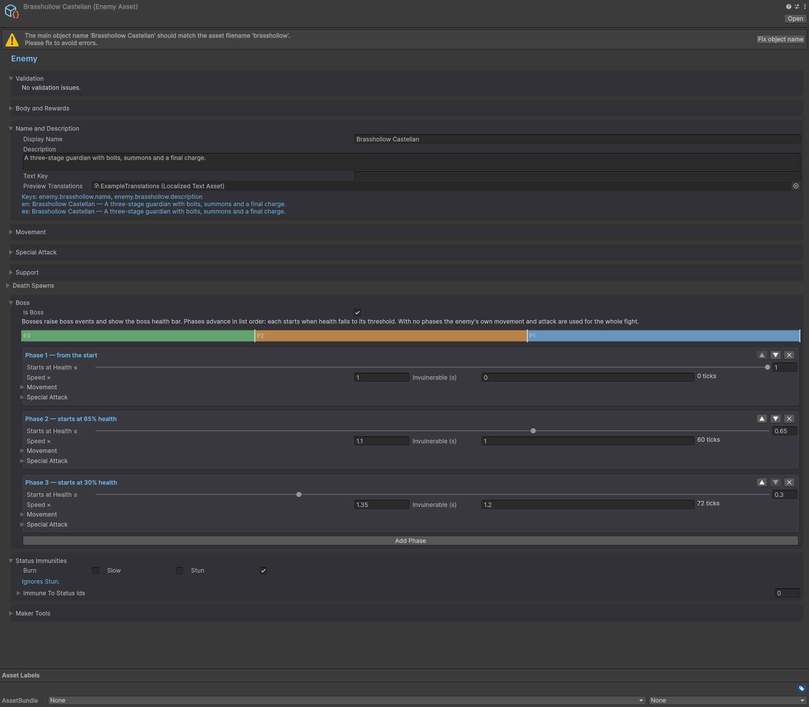

# Boss Wave

## Goal

Create a boss encounter.

## Procedure

1. Create an EnemyAsset with IsBoss and ordered phase thresholds.
2. Assign movement/attack overrides and valid summon references for each phase.
3. Schedule the boss in a wave; add a Horde event for additional pressure if wanted.
4. Enable EndOnBossDeath only when that wave actually produces a boss encounter.
5. Record Horde Preview and run fixed-build trials before playing the scene.

## Verify

Observe boss spawn/phase/defeat events and verify the wave ends at the intended boundary.

## Entry point and reference fields

**Entry point:** Use the corresponding Content inspector and Tools/Survivor Roguelite Maker/ tools.

| Field / API | Purpose |
|---|---|
| `IsBoss / Phases` | Boss definition |
| `Hordes` | Timed supporting bursts |
| `EndOnBossDeath` | Encounter completion policy |

## Figure

Enemy inspector with boss phases and wave-scaled previews.

## Check your result

Validate connected content before starting a new measurement or run. Keep the settings, seed and content version with any result you compare. For code-only adapters, compile against the package version you ship and configure the required authored data before gameplay.

[Documentation home](../index.md) · [Weapon Evolution](weapon-evolution.md) · [Status Weapon](status-weapon.md) · [Custom Weapon](custom-weapon.md)
