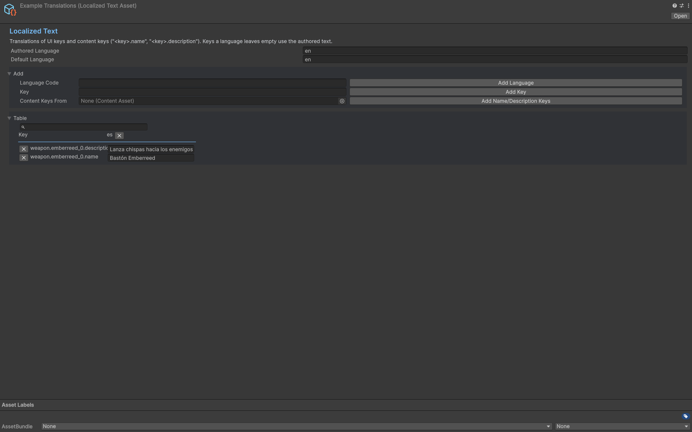

# Localized UI

## Goal

Localize content and UI.

## Procedure

1. Keep content ids fixed; author readable DisplayName/Description fallbacks.
2. Assign TextKey for entries requiring localized text.
3. Fill a LocalizedTextAsset or implement ITextProvider.
4. Assign bootstrap.Text, then choose the desired user language through options.
5. Test missing keys and a second language without altering any save id.

## Verify

Translated labels change while inventory/save identity stays the same.

## Entry point and reference fields

**Entry point:** Use the corresponding Content inspector and Tools/Survivor Roguelite Maker/ tools.

| Field / API | Purpose |
|---|---|
| `TextKey` | Translation lookup |
| `Text` | Bootstrap provider |
| `Language` | Options choice |

## Figure

Localized Text asset with English and Spanish text entries.

## Check your result

Validate connected content before starting a new measurement or run. Keep the settings, seed and content version with any result you compare. For code-only adapters, compile against the package version you ship and configure the required authored data before gameplay.

[Documentation home](../index.md) · [Weapon Evolution](weapon-evolution.md) · [Boss Wave](boss-wave.md) · [Status Weapon](status-weapon.md)
