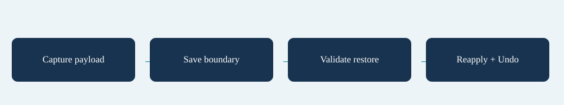

# Saved Effect

## Goal

Save a custom effect safely.

## Procedure

1. Include ExampleSavedEffect from the handler guide.
2. Register example.saved on the converted RunContent.EffectHandlers before creating/loading runs.
3. Author an Effect with that Handler id and valid target/amount.
4. Capture only at an eligible between-wave boundary and restore into matching content.
5. Verify the saved contribution, Undo and malformed-payload rejection.

## Verify

Restore must return a record for the supplied definition/store, without mutating shared definitions or global handler state.

## Entry point and reference fields

**Entry point:** Use the corresponding Content inspector and Tools/Survivor Roguelite Maker/ tools.

| Field / API | Purpose |
|---|---|
| `Handler` | example.saved |
| `Capture / Restore` | Value codec |
| `CanSave` | Boundary check |

## Figure

Concept diagram.

## Check your result

Validate connected content before starting a new measurement or run. Keep the settings, seed and content version with any result you compare. For code-only adapters, compile against the package version you ship and configure the required authored data before gameplay.

[Documentation home](../index.md) · [Weapon Evolution](weapon-evolution.md) · [Boss Wave](boss-wave.md) · [Status Weapon](status-weapon.md)
