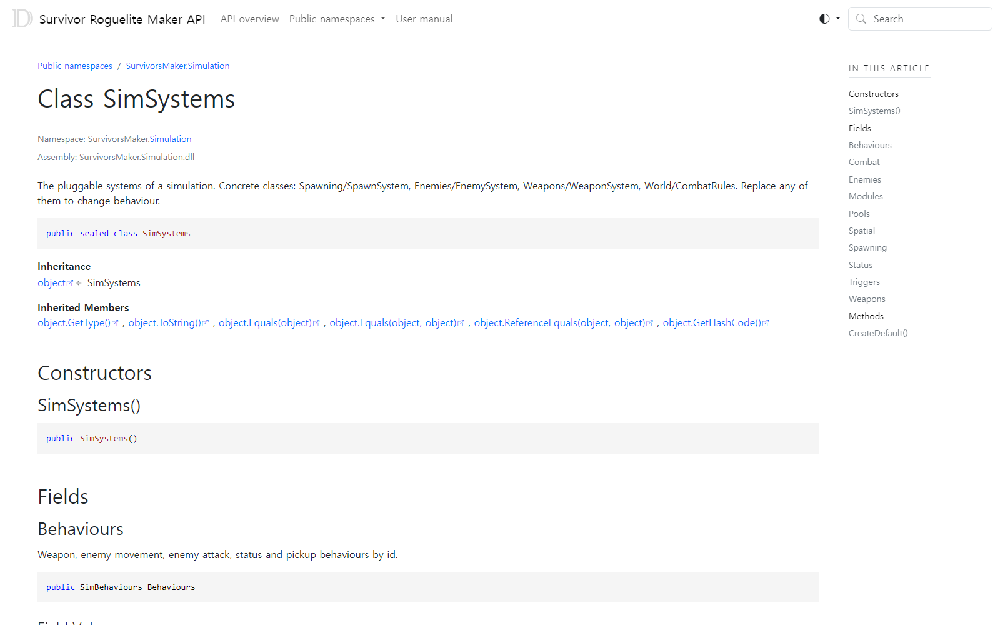

# API

[Open the public API reference](https://hyunter777.github.io/survivor-roguelite-maker-docs/api/).

Browse the public types, signatures and XML summaries by namespace.

Use Core for stats/effects, Simulation for one-wave systems/entities, Run for inventory/flow/saves, Data for asset conversion, Presentation for Unity adapters, Balance for analysis and Editor for authoring helpers. Each example guide explains its required assembly boundary.

Select the API version matching the installed package.

## Entry point and reference fields

**Entry point:** Code-only: use the API reference for the named types.

| Field / API | Purpose |
|---|---|
| `StatBuild` | Stats and explanations |
| `RunController` | Validated run actions |
| `SimSystems / RunSystems` | Composition roots |
| `IMakerAnalysis` | Headless experiments |

## Figure

SimSystems in the public API reference.

## Check your result

Validate connected content before starting a new measurement or run. Keep the settings, seed and content version with any result you compare. For code-only adapters, compile against the package version you ship and configure the required authored data before gameplay.

[Documentation home](../index.md) · [Troubleshooting](../help/troubleshooting.md) · [FAQ](../help/faq.md) · [Release Notes](../release-notes.md)
