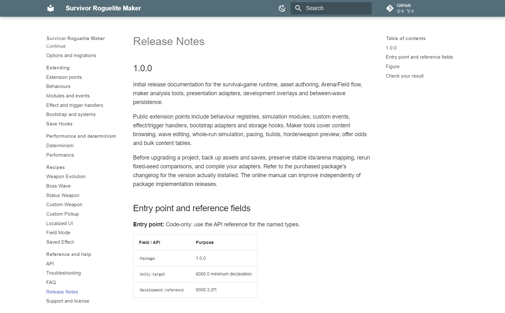

# Release Notes

## 1.0.0

Initial release documentation for the survival-game runtime, asset authoring, Arena/Field flow, maker analysis tools, presentation adapters, development overlays and between-wave persistence.

Public extension points include behaviour registries, simulation modules, custom events, effect/trigger handlers, bootstrap adapters and storage hooks. Maker tools cover content browsing, wave editing, whole-run simulation, pacing, builds, horde/weapon preview, offer odds and bulk content tables.

Before upgrading a project, back up assets and saves, preserve stable ids/arena mapping, rerun fixed-seed comparisons, and compile your adapters. Refer to the purchased package's changelog for the version actually installed. The online manual can improve independently of package implementation releases.

## Entry point and reference fields

**Entry point:** Code-only: use the API reference for the named types.

| Field / API | Purpose |
|---|---|
| `Package` | 1.0.0 |
| `Unity target` | 6000.0 minimum declaration |
| `Development reference` | 6000.3.2f1 |

## Figure

Release Notes for version 1.0.0.

## Check your result

Validate connected content before starting a new measurement or run. Keep the settings, seed and content version with any result you compare. For code-only adapters, compile against the package version you ship and configure the required authored data before gameplay.

[Documentation home](index.md) · [API](reference/api.md) · [Troubleshooting](help/troubleshooting.md) · [FAQ](help/faq.md)
