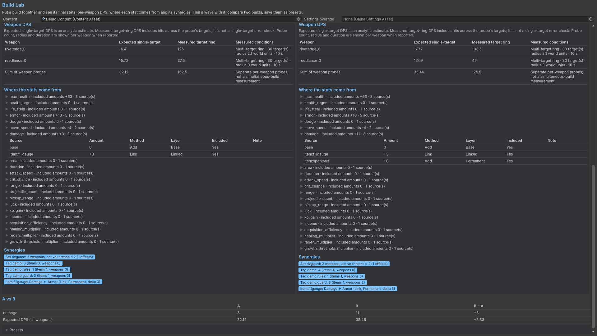

# Build Lab

Select a character, weapon tier ids, repeated items/upgrades, level and trial wave. Evaluate the fixed build to see final stats, per-weapon expected DPS, contribution rows, active sets, tag counts and linked effects. Run repeated fixed-build trials for survival, kills, time alive and damage taken. Use the comparison/preset controls to keep two builds or save a regression build selection.

Contribution Amount is an effective delta. A Set can subtract an earlier fold; a Limit can reduce the result; efficiency and final rounding affect the sum. Source identifies the provider, while Input Source identifies a dependency such as currency. Custom-handler net contributions appear in the Store residual. Convert recipes do not spend resources during evaluation: completed gains appear as their generated ledger entries.

Expected weapon DPS and measured scenario DPS answer different questions. A weapon outside range, a moving target or a sparse crowd can produce a lower measured value. Use a whole-run simulation to include shopping decisions.

## Entry point and reference fields

**Entry point:** Tools/Survivor Roguelite Maker/Build Lab

| Field / API | Purpose |
|---|---|
| `BuildSpec` | Character, weapon tier ids, repeated item ids, level |
| `Trial wave / Repeats` | Fixed-build experiment |
| `Contributions / Synergies` | Effective stat deltas and build structure |

## Figure

Product capture.

## Check your result

Validate connected content before starting a new measurement or run. Keep the settings, seed and content version with any result you compare. For code-only adapters, compile against the package version you ship and configure the required authored data before gameplay.

[Documentation home](../index.md) · [Index](index.md) · [Content Browser](content-browser.md) · [Wave Editor](wave-editor.md)
