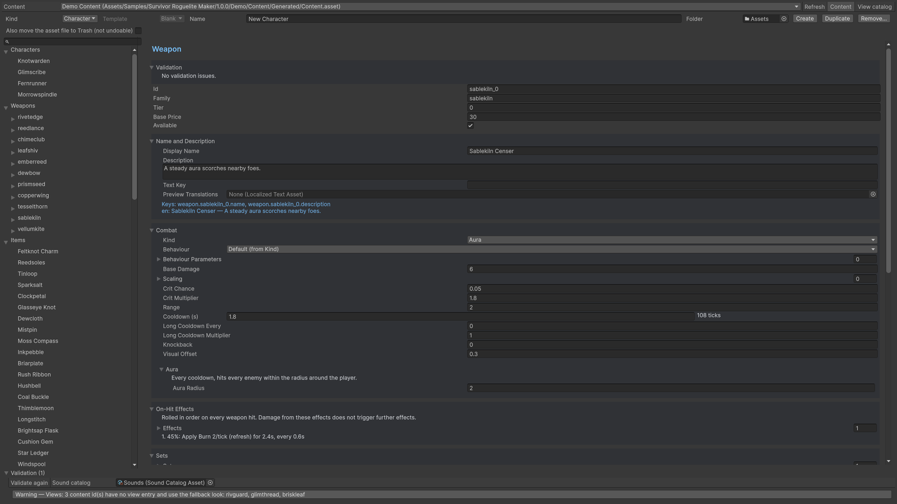

# Content Browser

Content Browser gathers the connected content graph and validation issues. Use it after adding assets or changing ids, tiers and references. Use its results together with the conditional inspectors, then play the scene.

Wave Editor exposes wave/groups/entries and expected spawning over time. Compare expected schedule counts with admitted spawns in a real run. Compare the schedule with a recorded Horde Preview and measured Run Pacing results. Asset edits use Unity Undo; keep a content version in source control for repeatable analysis.

## Entry point and reference fields

**Entry point:** Tools/Survivor Roguelite Maker/Content Browser

| Field / API | Purpose |
|---|---|
| `Content` | Graph to browse/validate |
| `Search/category` | Narrow asset entries |
| `Issues` | Fix references/rules before trials |

## Figure

Content Browser with a selected weapon and validation results.

## Check your result

Validate connected content before starting a new measurement or run. Keep the settings, seed and content version with any result you compare. For code-only adapters, compile against the package version you ship and configure the required authored data before gameplay.

[Documentation home](../index.md) · [Index](index.md) · [Wave Editor](wave-editor.md) · [Balance Simulator](balance-simulator.md)
