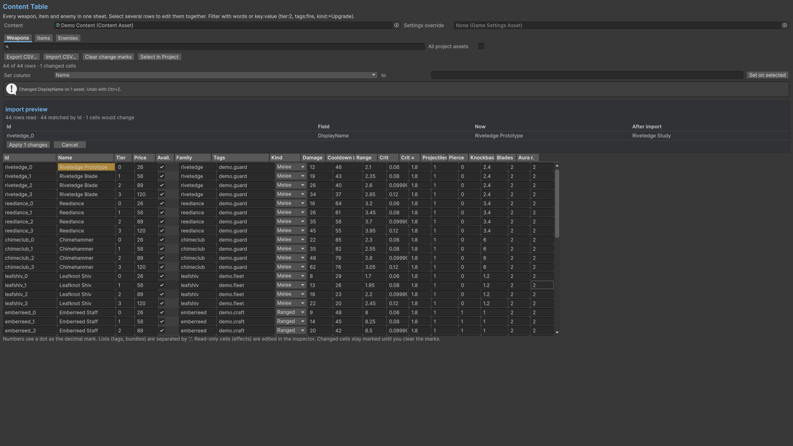

# Content Table

Choose content/category, filter or sort rows and edit supported columns. Use CSV export to review values externally. Import into the preview first, inspect errors/conflicts, then apply valid changes with Undo. Edit nested fields and references in their asset inspectors. Keep the exported header/schema and inspect ids carefully before applying a large batch.

## Entry point and reference fields

**Entry point:** Tools/Survivor Roguelite Maker/Content Table

| Field / API | Purpose |
|---|---|
| `Category / Filter` | Rows in scope |
| `CSV header/schema` | Supported import fields |
| `Preview / Apply` | Inspect conflicts before mutation |

## Figure

Product capture.

## Check your result

Validate connected content before starting a new measurement or run. Keep the settings, seed and content version with any result you compare. For code-only adapters, compile against the package version you ship and configure the required authored data before gameplay.

[Documentation home](../index.md) · [Index](index.md) · [Content Browser](content-browser.md) · [Wave Editor](wave-editor.md)
