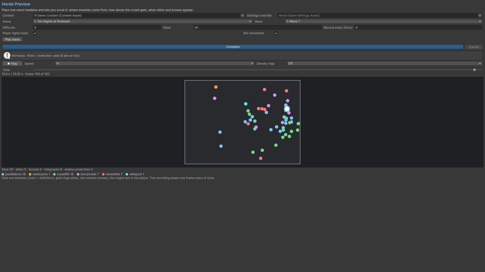

# Horde Preview

Record a wave with a seed, difficulty, player/bot setup and frame interval. Scrub recorded frames with the time slider and inspect positions, counts and density. Scrubbing reads captured frames. A smaller record interval improves temporal detail and increases memory use.

The preview displays schematic enemy positions and density. Record again after changing a definition or seed.

## Entry point and reference fields

**Entry point:** Tools/Survivor Roguelite Maker/Horde Preview

| Field / API | Purpose |
|---|---|
| `RecordEveryTicks` | Frame spacing |
| `Wave / Seed` | Deterministic recording input |
| `Frames` | Value snapshots for scrubbing |

## Figure

Product capture.

## Check your result

Validate connected content before starting a new measurement or run. Keep the settings, seed and content version with any result you compare. For code-only adapters, compile against the package version you ship and configure the required authored data before gameplay.

[Documentation home](../index.md) · [Index](index.md) · [Content Browser](content-browser.md) · [Wave Editor](wave-editor.md)
