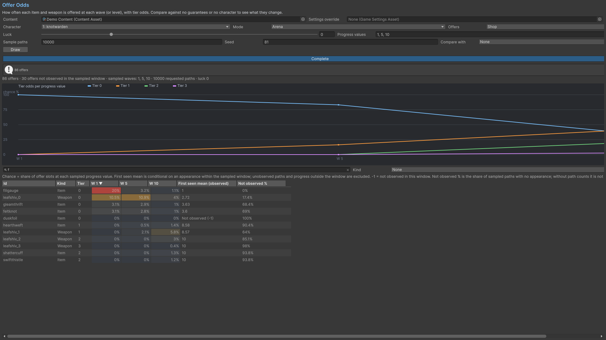

# Offer Odds

Select character, mode, Shop or Level-up, Luck, progress values, sample-path count and seed. Draw a baseline, then use Compare With to isolate guarantee or character-policy changes. Progress means waves in Arena mode and levels in Field mode.

Chance is the share of offer slots containing an id at a sampled progress value. First Seen Mean averages the first appearance among observed paths in the sampled window. A value of -1 marks an unobserved entry in that window. Not Observed % needs the report's path counts. Read observed-path counts alongside each result.

Weights, guarantees, bans, ownership and eligibility interact. Use whole-run simulation and direct play to measure purchasing histories. Select the Luck binding from your request/settings when customizing stat bindings.

## Entry point and reference fields

**Entry point:** Tools/Survivor Roguelite Maker/Offer Odds

| Field / API | Purpose |
|---|---|
| `Mode / Offers` | Arena/Field and Shop/Level-up |
| `Progress values` | Waves or levels |
| `Sample paths / Seed` | Sampling experiment |
| `Compare with` | Guarantee/character-policy comparison |

## Figure

Product capture.

## Check your result

Validate connected content before starting a new measurement or run. Keep the settings, seed and content version with any result you compare. For code-only adapters, compile against the package version you ship and configure the required authored data before gameplay.

[Documentation home](../index.md) · [Index](index.md) · [Content Browser](content-browser.md) · [Wave Editor](wave-editor.md)
