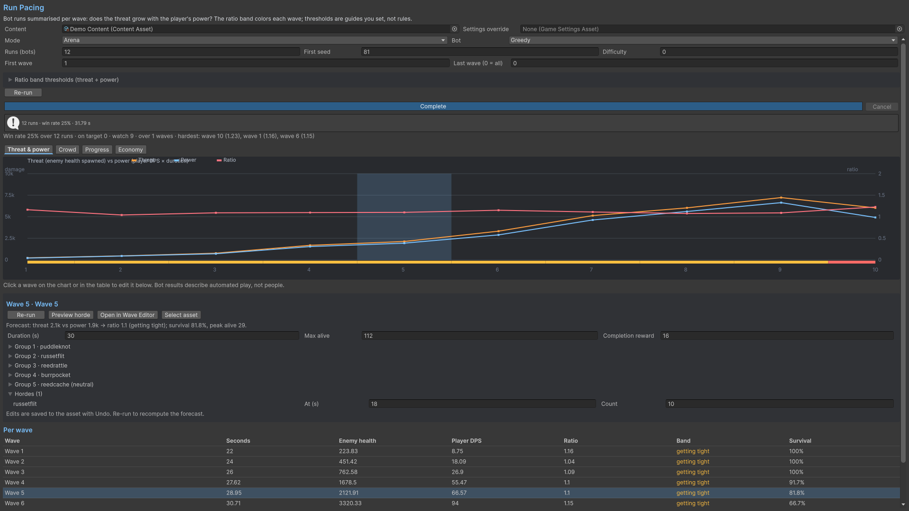

# Run Pacing

Pick Content, mode, bot, run count, first seed, difficulty and wave range, then start the forecast. The job advances in slices and can be cancelled. Cancellation returns completed samples. Read entered-run counts alongside the averages.

Read threat and power together: spawned enemy health, average/peak live enemies, incoming player damage, player DPS and survival. Threat To Power compares spawned enemy health with DPS times wave duration. Read it alongside survival, density and incoming damage. Level, experience, income, expenditure and shop-price series help expose growth/economy mismatches.

Reports use wave samples, including Field mode. Read the graph by wave number. Compare the same bot policy and seed range across edits. Compare identical seeds/settings before and after an edit, and check how many runs reached later waves.

## Entry point and reference fields

**Entry point:** Tools/Survivor Roguelite Maker/Run Pacing

| Field / API | Purpose |
|---|---|
| `Runs (bots) / First seed` | Sample size and reproducibility |
| `First wave / Last wave` | Report window |
| `RunsEntered` | Denominator for later-wave statistics |

## Figure

Product capture.

## Check your result

Validate connected content before starting a new measurement or run. Keep the settings, seed and content version with any result you compare. For code-only adapters, compile against the package version you ship and configure the required authored data before gameplay.

[Documentation home](../index.md) · [Index](index.md) · [Content Browser](content-browser.md) · [Wave Editor](wave-editor.md)
