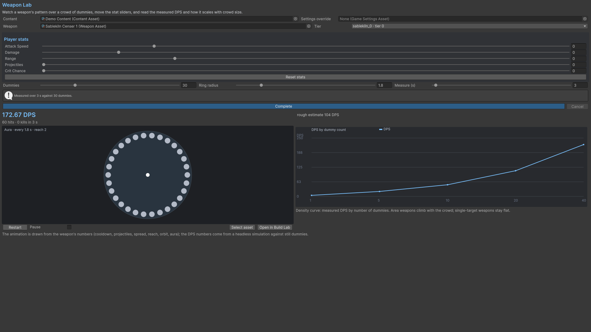

# Weapon Lab

Choose a WeaponAsset/tier, stat sliders, dummy count, ring radius and measurement length. Compare the rough estimate with measured DPS, hit/kill counts and the density curve. Use the visual preview to see range, projectile and orbit/aura behaviour; pause it when examining a configuration.

Re-measure after changing stats or weapon fields. A measured number is specific to this target layout, time interval and seed. Register custom behaviours in both the scene systems and the analysis systems.

## Entry point and reference fields

**Entry point:** Tools/Survivor Roguelite Maker/Weapon Lab

| Field / API | Purpose |
|---|---|
| `Dummies / Ring radius` | Target layout |
| `Measure (s)` | Measurement interval |
| `Tier / Stats` | Weapon and build modifiers |

## Figure

Product capture.

## Check your result

Validate connected content before starting a new measurement or run. Keep the settings, seed and content version with any result you compare. For code-only adapters, compile against the package version you ship and configure the required authored data before gameplay.

[Documentation home](../index.md) · [Index](index.md) · [Content Browser](content-browser.md) · [Wave Editor](wave-editor.md)
