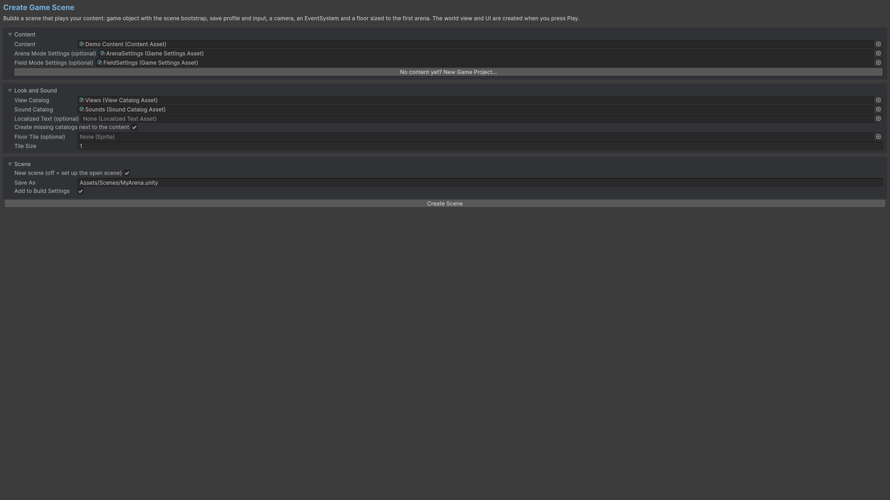

# Wizards and validation

Use **Tools/Survivor Roguelite Maker/Create Game Scene...**. Assign your Content, optional mode-specific settings, view/sound catalogs and scene path. The wizard creates or wires a bootstrap, game, camera, input, UI and floor. Its create-missing-catalogs option can fill empty catalog references.

Use **Tools/Survivor Roguelite Maker/Build UI Prefabs** when you need editable generated UI prefabs. This is separate from content generation.

Use Display Name and Description for readable defaults, and Text Key with a `LocalizedTextAsset`/`ITextProvider` for localized strings. Keep ids unchanged when translating. Assign the text asset on the bootstrap; UI content names and descriptions then use that provider with fallback text.

Open **Tools/Survivor Roguelite Maker/Content Browser** and validate your selected content. Also review inspector warnings for invalid numbers, missing references, duplicate ids, rule configuration errors and tier cycles. Run whole-content validation before play. Validate the whole registry after editing interconnected assets or importing CSV.

## Entry point and reference fields

**Entry point:** Tools/Survivor Roguelite Maker/Create Game Scene...

| Field / API | Purpose |
|---|---|
| `NewGameProjectOptions.Folder` | Project-owned output root |
| `GameSceneOptions.Content` | Existing content graph |
| `CreateMissingCatalogs` | Optional fallback catalog creation |
| `Validate` | Resolve whole-graph issues |

## Figure

Create Game Scene wizard with content, catalogs and output paths.

## Check your result

Validate connected content before starting a new measurement or run. Keep the settings, seed and content version with any result you compare. For code-only adapters, compile against the package version you ship and configure the required authored data before gameplay.

[Documentation home](../index.md) · [Index](index.md) · [Content Browser](content-browser.md) · [Wave Editor](wave-editor.md)
